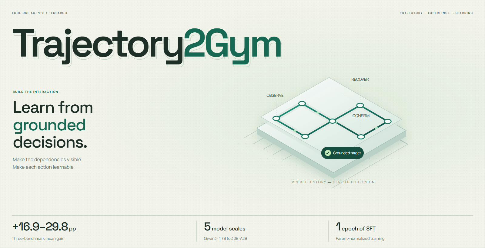

# Trajectory2Gym — Project Homepage

[](https://yihaohu0118.github.io/Trajectory2Gym-page/)

**Decision-Grounded Compositional Interaction Synthesis for Tool-Use Agents**

[Project homepage](https://yihaohu0118.github.io/Trajectory2Gym-page/) ·
[Paper PDF](https://yihaohu0118.github.io/Trajectory2Gym-page/assets/Trajectory2Gym.pdf) ·
[Research repository](https://github.com/yihaohu0118/Trajectory2Gym)

This repository contains the static project website, manuscript PDF, and
presentation assets only. **Implementation code is not yet released.**
The separate research repository is currently empty.

## Website

Serve `site/` with any static web server, for example:

```sh
python -m http.server 8000 --directory site
```

GitHub Actions publishes `site/` to GitHub Pages on pushes to `main`.
The site has no build step or external JavaScript dependencies.

The interactive supervision example paraphrases the constructed example in
Figure 1 of the paper. It is a conceptual explanation, not live inference.
The benchmark data comes from Tables 1 and 2. The project poster is an original
SVG/CSS illustration, with motion controls and a static PNG download.
Research figures are exported from the manuscript; the complete protocols and
limitations remain in the paper.

Manrope and Space Grotesk are self-hosted under their included SIL Open Font
License files. Paper and research figure rights remain with their authors.
